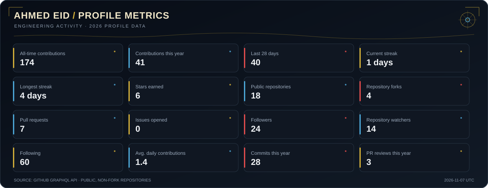
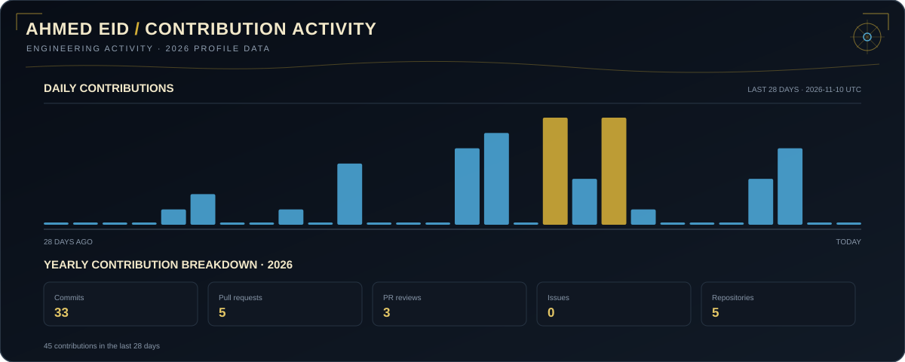
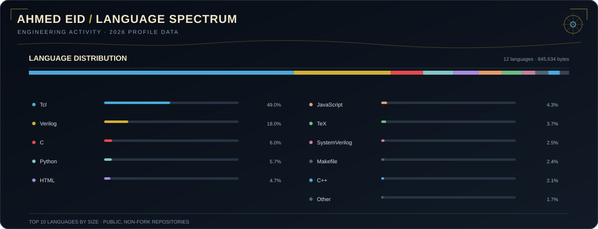
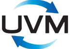
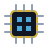

<h1 align="center">Hi 👋, I'm Ahmed Eid</h1>
<h3 align="center">Digital IC Design & Verification Engineer from Egypt 🇪🇬</h3>

  

---

  

---

### 👨‍💻 About Me

- 📜 Pursuing my **M.Sc.** in Computer and Systems Engineering at **Ain Shams University**.
- 🎓 Alumnus of **Cairo University** (EECE 2024).
- 🏗️ Focused on **UVM, AXI Protocols, FPGA Design**, and Advanced Computer Architecture.
- 🤖 Passionate about the intersection of **Hardware and AI**.

---

### 📊 GitHub Metrics & Activity

  

  

  

---

### 🛠️ Languages and Tools

  <table>
    <tr>
      <td width="33%" align="center">
        <b>Hardware & Verification</b>  
        <table>
          <tr>
            <td align="center"><a href="https://standards.ieee.org/ieee/1800/7743/"> SystemVerilog</a></td>
            <td align="center"><a href="https://www.accellera.org/downloads/standards/uvm"> UVM</a></td>
          </tr>
          <tr>
            <td align="center"><a href="https://standards.ieee.org/ieee/1076/5179/"> VHDL</a></td>
            <td align="center"><a href="https://www.amd.com/en/products/adaptive-socs-and-fpgas.html"> FPGA</a></td>
          </tr>
        </table>
      </td>
      <td width="33%" align="center">
        <b>EDA & Simulation</b>  
        <table>
          <tr>
            <td align="center"><a href="https://www.amd.com/en/products/software/adaptive-socs-and-fpgas/vivado.html"> Vivado</a></td>
            <td align="center"><a href="https://www.siemens.com/en-us/products/ic/questa-one/"> Questa</a></td>
          </tr>
          <tr>
            <td align="center"><a href="https://www.mathworks.com/products/matlab.html"> MATLAB</a></td>
            <td align="center"><a href="https://www.synopsys.com/implementation-and-signoff.html"> Synopsys</a></td>
          </tr>
        </table>
      </td>
      <td width="33%" align="center">
        <b>Programming & Scripting</b>  
        <table>
          <tr>
            <td align="center"><a href="https://www.python.org/"> Python</a></td>
            <td align="center"><a href="https://isocpp.org/"> C++</a></td>
          </tr>
          <tr>
            <td align="center"><a href="https://www.kernel.org/"> Linux</a></td>
            <td align="center"><a href="https://git-scm.com/"> Git</a></td>
          </tr>
        </table>
      </td>
    </tr>
  </table>

---

### 📫 Connect with me:

  
  &nbsp;&nbsp;
  

---

"Building the hardware of tomorrow, one gate at a time."
